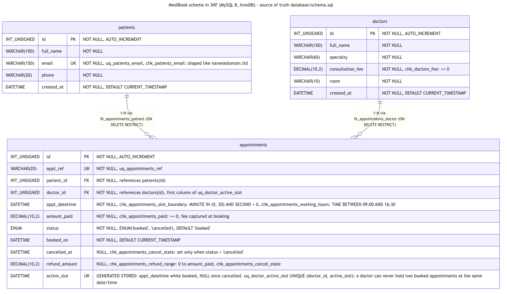

# MediBook API

Backend for a community clinic's appointment system. Patients book doctors in fixed 30-minute slots during working hours, each doctor sees at most 12 patients a day, cancellations are refunded according to the notice given, and fully booked days have a waitlist that a separate worker process promotes from automatically.

**Stack:** Node.js 20+, Express 5, MySQL 8.4 (`mysql2`, parameterized queries only, no ORM), Redis 7.4 (`redis` client), Jest, Swagger UI.

**Walkthrough video:** https://youtu.be/BcBU9EeHHzs

---

## Contents

1. [Setup](#setup)
2. [Project structure](#project-structure)
3. [Database design (Parts A & B)](#database-design-parts-a--b)
4. [API overview](#api-overview)
5. [Design decisions: booking & cancellation (Part C)](#design-decisions-booking--cancellation-part-c)
6. [Audit log with `fs` (Part D)](#audit-log-with-fs-part-d)
7. [Waitlist & notification queues (Part E)](#waitlist--notification-queues-part-e)
8. [Unit tests (Part F)](#unit-tests-part-f)
9. [Course feedback page, i18n & l10n (Part G)](#course-feedback-page-i18n--l10n-part-g)

---

## Setup

### Prerequisites

- Node.js 20 or newer
- Docker with Docker Compose (runs MySQL and Redis; nothing needs installing on the host)

### 1. Configure the environment

```bash
cp .env.example .env
```

`.env.example`:

```dotenv
PORT=3000
TZ=Africa/Accra

DB_HOST=127.0.0.1
DB_PORT=3307
DB_USER=medibook
DB_PASSWORD=change-me
DB_NAME=medibook
DB_ROOT_PASSWORD=change-me-too

REDIS_HOST=127.0.0.1
REDIS_PORT=6380

LOG_DIR=logs
```

| Variable | Purpose |
|---|---|
| `PORT` | HTTP port of the API |
| `TZ` | Clinic time zone. All slot times are clinic-local, and the API and MySQL use the same zone |
| `DB_*` | MySQL connection; also used by `docker-compose.yml` to create the database and user |
| `DB_ROOT_PASSWORD` | Root password for the MySQL container (only Docker uses it) |
| `REDIS_HOST`, `REDIS_PORT` | Redis connection for the waitlist and notification queues |
| `LOG_DIR` | Directory for `audit.log` (created automatically) |

Host ports `3307` and `6380` are used so the containers do not clash with a MySQL or Redis already installed locally. Change the passwords before the first `docker compose up`; MySQL only reads them when it creates its data volume.

### 2. Start MySQL and Redis

```bash
docker compose up -d
docker compose ps        # wait until medibook-mysql shows (healthy)
```

On first start the MySQL container runs `database/schema.sql` and then `database/seed.sql` automatically. Redis runs with append-only persistence, so queued waitlist entries survive a restart.

To reset the database to the seed state at any time:

```bash
docker compose down -v && docker compose up -d
```

### 3. Install and run

```bash
npm install
npm start               # API on http://localhost:3000
npm run worker          # in a second terminal: waitlist + notification worker
```

| Command | What it does |
|---|---|
| `npm start` | Starts the API |
| `npm run worker` | Starts the background worker (a separate process from the API) |
| `npm run dev` / `npm run dev:worker` | Same, restarted automatically by nodemon on code changes |
| `npm test` | Runs the Jest unit tests (no MySQL or Redis needed) |

### 4. Explore

- **Swagger UI:** http://localhost:3000/docs. Every endpoint, with "Try it out". `/` redirects here.
- **Health check:** http://localhost:3000/health reports whether MySQL and Redis are reachable.
- **Feedback page:** http://localhost:3000/feedback and http://localhost:3000/feedback?lang=fr
- **Audit log:** `tail -f logs/audit.log`

> **Seed dates are relative.** Historical rows use fixed 2026 dates copied from the clinic spreadsheet. Upcoming appointments are seeded relative to `CURDATE()`, so the near-cap day, the busy day and the 7-day statistics always fall in the future whenever the seed runs. Two appointments are placed relative to `NOW()` instead: AP-401 at the first slot at least 6 hours away (always less than 24 h of notice, so a 0% refund) and AP-402 one day later (always 24–48 h, so 50%). The refund tiers can therefore be demonstrated at any time of day.

---

## Project structure

```
├── database/
│   ├── schema.sql            DDL: database, 3 tables, every constraint
│   └── seed.sql              sample data
├── docs/openapi.js           OpenAPI 3 spec served by Swagger UI at /docs
├── locales/                  en.json, fr.json (feedback page text)
├── schema-diagram.mmd        Mermaid source of the schema diagram
├── schema-diagram.png        exported diagram
├── src/
│   ├── config/               env.js (environment), rules.js (business constants)
│   ├── models/               all SQL lives here, and only here
│   ├── services/             booking, cancellation, waitlist and notification workflows
│   ├── controllers/          HTTP layer: parse input, call models/services, shape responses
│   ├── routes/               URL + method → controller
│   ├── middleware/           central error handler, 404 handler
│   ├── validators/           pure validation functions (field rules, slot check)
│   ├── queues/               Redis queues (waitlist, slot-freed events, notifications)
│   ├── redis/                Redis client
│   ├── i18n/, views/         locale resolution and the feedback page
│   ├── utils/                refund calculator, audit logger, date helpers, errors
│   ├── app.js                Express app
│   ├── server.js             API entry point (npm start)
│   └── worker.js             worker entry point (npm run worker)
└── tests/                    Jest unit tests
```

**Layering.** Routes only map URLs to controllers. Controllers validate input and call models (for CRUD) or services (for multi-step workflows). Services hold business logic that both the API and the worker need, such as booking a slot, so the worker reuses exactly the same rules as the HTTP endpoint. Models hold all SQL. Every statement uses `?` placeholders through `mysql2`'s `execute`, and no SQL string is ever built from user input.

**Business values are defined once** in `src/config/rules.js`: slot length, working hours, the 12-per-day cap, the busy-day threshold, the refund tiers, pagination limits and queue timings.

---

## Database design (Parts A & B)



Source: [`schema-diagram.mmd`](schema-diagram.mmd) (Mermaid). DDL: [`database/schema.sql`](database/schema.sql).

### Normalization (spreadsheet → 3NF)

| Spreadsheet columns | Now lives in | Reason |
|---|---|---|
| `patient_name`, `patient_email`, `patient_phone` | `patients` | Facts about the patient that were repeated on every booking (Ama Mensah appears twice) |
| `doctor_name`, `specialty`, `consultation_fee`, `room` | `doctors` | Depend on the doctor, not on the booking (removes the transitive dependency `appt_ref → doctor → fee`) |
| `appt_ref`, `appt_datetime`, `booked_on` | `appointments` | Facts about one booking; patient and doctor are replaced by foreign keys |
| `amount_paid` | `appointments` | Depends on the booking, not the doctor: AP-002 paid 120.00 against a 150.00 fee |
| *(new)* `status`, `cancelled_at`, `refund_amount` | `appointments` | The cancellation and refund record live on the booking they belong to |

Relationships: `patients 1 ── N appointments` and `doctors 1 ── N appointments`, both `ON DELETE RESTRICT`, so a patient or doctor with appointment history cannot be deleted (the API answers `409`).

### Constraints that enforce business rules

| Constraint | Rule |
|---|---|
| `uq_doctor_active_slot UNIQUE (doctor_id, active_slot)` | A doctor can never hold two booked appointments at the same date/time (see below) |
| `chk_appointments_slot_boundary` | `MINUTE IN (0, 30) AND SECOND = 0`: slots start on a 30-minute boundary |
| `chk_appointments_working_hours` | `TIME BETWEEN '09:00:00' AND '16:30:00'`: the last slot starts at 16:30 and ends at 17:00 |
| `chk_appointments_cancel_state` | A booked row has no `cancelled_at`/`refund_amount`; a cancelled row has both |
| `chk_appointments_refund_range` | `0 ≤ refund_amount ≤ amount_paid` |
| `chk_appointments_paid`, `chk_doctors_fee` | Money is never negative |
| `uq_patients_email`, `chk_patients_email` | Each email belongs to one patient and has a basic valid shape |
| `uq_appointments_ref` | Booking references are unique |

**Why `active_slot`?** A plain `UNIQUE (doctor_id, appt_datetime)` would stop a cancelled slot from ever being booked again, unless the cancelled row were deleted, which would lose its refund history. Instead, `active_slot` is a stored generated column: it equals `appt_datetime` while the row is `booked` and becomes `NULL` when it is `cancelled`. MySQL unique indexes allow any number of `NULL`s, so the index only covers active bookings. In the seed data, AP-004 (cancelled) and AP-005 (booked) share Dr. Ansah's 2026-09-02 11:00 slot, which is exactly this case.

**Rules that cannot be CHECK constraints.** "Future only" needs `NOW()`, which MySQL forbids in a CHECK. "At most 12 per day" spans many rows. Both are enforced in the booking transaction described below.

Types: money is `DECIMAL(10,2)` (exact, never floating point), slots are `DATETIME`, and keys are `INT UNSIGNED`. All tables use InnoDB, which provides transactions, row-level locks and enforced foreign keys.

---

## API overview

Full request/response documentation with examples is in Swagger at `/docs`.

| Method | Path | Purpose | Success |
|---|---|---|---|
| GET | `/health` | MySQL + Redis connectivity | 200 / 503 |
| GET | `/patients` | List patients (`limit`, `offset`) | 200 |
| POST | `/patients` | Create a patient | 201 + `Location` |
| GET | `/patients/:id` | Get one patient | 200 |
| PATCH | `/patients/:id` | Partial update | 200 |
| DELETE | `/patients/:id` | Delete (only without appointment history) | 204 |
| GET | `/doctors` | List doctors (`specialty`, `limit`, `offset`) | 200 |
| POST | `/doctors` | Create a doctor | 201 + `Location` |
| GET | `/doctors/:id` | Get one doctor | 200 |
| PATCH | `/doctors/:id` | Partial update | 200 |
| DELETE | `/doctors/:id` | Delete (only without appointment history) | 204 |
| GET | `/doctors/:id/stats` | Revenue, upcoming count, 7-day load, utilization | 200 |
| GET | `/doctors/:id/waitlist?date=` | View a doctor's waitlist for a day | 200 |
| POST | `/doctors/:id/waitlist` | Join the waitlist for a full slot/day | 201 |
| GET | `/appointments` | List (`doctor_id`, `patient_id`, `date`, `status`) | 200 |
| POST | `/appointments` | **Book** | 201 + `Location` |
| GET | `/appointments/:id` | Get one (including cancelled ones and their refund) | 200 |
| DELETE | `/appointments/:id` | **Cancel** (soft delete, refund computed) | 200 |
| GET | `/reports/doctors` | Appointments and revenue per doctor | 200 |
| GET | `/reports/busy-days` | Doctor-days over 80% of capacity | 200 |
| GET / POST | `/feedback` | Localised course-feedback page | 200 / 201 |

### Status codes and error format

Every error has the same shape, produced by one central error-handling middleware:

```json
{ "error": { "code": "SLOT_TAKEN", "message": "Dr. Kwabena Boateng already has an appointment at 2026-12-01 09:00:00", "details": { "...": "..." } } }
```

| Status | Meaning | Examples |
|---|---|---|
| `400` | Malformed input | missing/unknown fields, bad JSON, `id=abc`, `2026-02-30T10:00` |
| `404` | Unknown id or route | `PATIENT_NOT_FOUND`, `DOCTOR_NOT_FOUND`, `APPOINTMENT_NOT_FOUND` |
| `409` | Conflicts with current state | `SLOT_TAKEN`, `DOCTOR_DAY_FULL`, `EMAIL_TAKEN`, `ALREADY_CANCELLED`, `ALREADY_WAITLISTED`, `PATIENT_HAS_APPOINTMENTS` |
| `422` | Well-formed but breaks a business rule | `SLOT_IN_PAST`, `SLOT_NOT_ON_BOUNDARY`, `SLOT_OUTSIDE_WORKING_HOURS`, `APPOINTMENT_ALREADY_STARTED`, `SLOT_AVAILABLE` |
| `503` | Redis unavailable for a waitlist operation | `QUEUE_UNAVAILABLE` |

The line between **400** and **422**: `400` means "I cannot read this request" (wrong type, impossible date), and `422` means "I understood it, but the clinic's rules forbid it" (09:15, 17:00, in the past). `409` is reserved for clashes with existing data that might succeed later, such as a slot someone else holds.

---

## Design decisions: booking & cancellation (Part C)

### REST design

- **Resources are nouns, verbs are HTTP methods.** Patients and doctors get full CRUD on `/patients` and `/doctors`.
- **`PATCH` for updates**, because clients usually change one field (a phone number, a fee). `PATCH` sends only those fields, and at least one is required.
- **Booking is `POST /appointments`.** It creates a resource, so it returns `201` with a `Location` header.
- **Cancellation is `DELETE /appointments/:id`.** The brief describes appointments as getting their create/delete behaviour from booking and cancelling, so cancellation is the delete operation. It is a **soft delete**: the row stays with `status = cancelled` for refund history, and the response (`200`, not `204`) states the refund, because the brief requires the response to include it.
- **Sub-resources express ownership:** `/doctors/:id/stats` and `/doctors/:id/waitlist` belong to one doctor. Reports that span all doctors live under `/reports`.
- **Patients and doctors share one CRUD controller factory** (`crudControllerFactory.js`), so list/get/create/update/delete logic is written once instead of copy-pasted.

### Booking rules and how each is enforced

| Rule | Enforcement |
|---|---|
| Future only, 09:00–17:00, 30-minute boundary | `checkAppointmentSlot` (a pure function, unit tested) → `422`. The working-hours and boundary rules are also CHECK constraints, as a database safety net |
| Max 12 per doctor per day | Counted inside the booking transaction after locking the doctor row → `409 DOCTOR_DAY_FULL` |
| No two patients in one slot, even at the same instant | Doctor-row lock plus `uq_doctor_active_slot` → `409 SLOT_TAKEN` |

**Concurrency.** Booking runs in one InnoDB transaction (`appointmentService.bookAppointment`):

1. `SELECT … FROM doctors WHERE id = ? FOR UPDATE` locks that doctor's row. A second booking for the **same doctor** waits here until the first commits, so bookings for one doctor run one after another. Bookings for other doctors are not blocked.
2. Check the patient exists, then count the doctor's active bookings that day. Because the count happens after the lock, it always sees the previous booking, so the 12-per-day cap cannot be overshot by two requests counting "11" at the same moment.
3. Insert. If the slot is somehow already held, the `uq_doctor_active_slot` unique index rejects the insert (MySQL error 1062), which is translated to `409 SLOT_TAKEN`. The index is the final guarantee and holds even for code paths that do not take the lock.

This was tested by firing **20 simultaneous requests for one slot** (exactly 1 × `201`, 19 × `409`) and **16 simultaneous requests for every slot of an empty day** (exactly 12 × `201`, 4 × `409`).

The price is taken server-side: `amount_paid` is the doctor's current `consultation_fee`, captured at booking time, so later fee changes do not rewrite history and clients cannot set their own price.

A `409` booking response includes a ready-to-use **waitlist offer** (`details.waitlist`) naming the endpoint and body needed to join the queue.

### Refund policy and its boundaries

The refund is computed by the server from the notice given (hours between cancellation and appointment start). The client never sends an amount.

| Notice | Refund |
|---|---|
| more than 48 h | 100% |
| 24 h to 48 h, **both ends inclusive** | 50% |
| less than 24 h | 0% |

Boundaries: **exactly 48 h → 50%** ("more than 48 hours" is strict), and **exactly 24 h → 50%** (24 h still counts as the 24–48 h tier). Cancelling an appointment that has already started is refused with `422`. Amounts are calculated in whole cents and rounded once, so `99.99 × 50%` gives `50.00`, not `49.995`. The calculator (`refundCalculator.js`) is a pure function, and both boundaries are unit tested.

### Cancellation is atomic

`appointmentService.cancelAppointment` runs one transaction: it locks the appointment row (`SELECT … FOR UPDATE`, so two simultaneous cancels cannot both refund), checks it is still `booked` and in the future, then writes `status`, `cancelled_at` and `refund_amount` in **a single `UPDATE`**. The cancellation and its refund record are the same row change, so they cannot be separated. `chk_appointments_cancel_state` also makes it impossible for the database to hold one without the other.

Once committed, `active_slot` becomes `NULL` (the slot is immediately bookable again), the row and its refund stay for history, and a slot-freed event is queued for the waitlist worker.

### Statistics and reports (advanced SQL)

All figures are computed by SQL in `src/models/reportModel.js`. JavaScript only converts types.

- **Doctor stats:** `LEFT JOIN` + conditional aggregates (`COUNT(CASE WHEN …)`) for revenue (`SUM(amount_paid - COALESCE(refund_amount, 0))`) and upcoming bookings. The 7-day breakdown uses a **recursive CTE** to generate every calendar day, so days with zero bookings still appear, and a **window function** (`SUM(COUNT(a.id)) OVER ()`) for the whole-window utilization.
- **Doctors report:** `doctors LEFT JOIN appointments … GROUP BY doctor`, so doctors with zero appointments (seeded Dr. Esi Quaye) appear with zeros.
- **Busy days:** `GROUP BY doctor, DATE(appt_datetime) HAVING COUNT(*) > cap × 0.8`. With a cap of 12, that means 10 or more active bookings (83.3%). The seed includes a 9-booking day (75%) that is correctly excluded.

"Revenue collected" means money actually kept: everything paid minus every refund issued.

---

## Audit log with `fs` (Part D)

`src/utils/auditLogger.js` appends one JSON object per line to `logs/audit.log`:

```json
{"timestamp":"2026-11-24T18:47:19.512Z","event":"appointment_cancelled","appointment_id":39,"appt_ref":"AP-D81C6433","notice_hours":67.71,"refund_percent":100,"refund_amount":"150.00", "...": "..."}
```

- **Async only:** `fs.promises.mkdir` and `fs.promises.appendFile`. There are no `*Sync` calls anywhere in `src/`.
- **Directory created on first run:** the logger appends straight to the file. If that fails with `ENOENT` (the folder doesn't exist yet, or was deleted while the app was running), it creates the folder with `mkdir(dir, { recursive: true })` and appends again.
- **A logging failure never fails the request:** `record()` catches every error, reports it to the console, and resolves to `false`. It never throws. Handlers call it without awaiting (`void auditLog.record(...)`), so the response is not delayed by disk I/O. This was tested by making `audit.log` read-only: bookings still returned `201`.
- **Events:** `appointment_booked` (with `source: api | waitlist`), `appointment_cancelled` (with the refund), `notification_sent`, `waitlist_joined`, `waitlist_promoted`, `waitlist_promotion_deferred`, `waitlist_promotion_failed`, `job_failed`, `course_feedback_submitted`. The API and the worker append to the same file. Each entry is a single small `appendFile` in append mode, so lines from the two processes do not interleave.

---

## Waitlist & notification queues (Part E)

### Components

| Redis key | Type | Role |
|---|---|---|
| `medibook:waitlist:doctor:{id}:{date}` | list | FIFO waitlist for one doctor-day |
| `medibook:waitlist:processing` | list | Entries the worker is currently trying to book |
| `medibook:waitlist:failed` | list | Entries that can never be booked, with the reason |
| `medibook:queue:slot-freed` (+ `:processing`, `:failed`) | list | Events emitted when a cancellation frees a slot |
| `medibook:queue:notifications` (+ `:processing`, `:failed`) | list | Confirmation jobs for every booked appointment |

The worker (`src/worker.js`, `npm run worker`) is a **separate Node process** from the API. It holds two blocking Redis connections and consumes the slot-freed and notification queues in parallel.

### Flow

1. A booking hits a full slot or a full day → `409` with a waitlist offer.
2. The patient joins: `POST /doctors/:id/waitlist` pushes them onto the end of that doctor-day list (`RPUSH`). Joining is refused if the slot is actually free (`422`) or the patient is already queued (`409`). The list expires at closing time that day, so stale waitlists clean themselves up.
3. A cancellation commits and then pushes a slot-freed event `{doctor_id, appt_datetime}`.
4. The worker takes the event (`BLMOVE` into a processing list), moves the first waiting patient into `waitlist:processing` (`LMOVE`), and books them through the **same** `bookAppointment` service the API uses, so every rule (future, cap, unique slot, transaction) applies.
5. On success, the processing entry is removed and the booking gets its own confirmation notification.

### When the promoted booking fails

The patient is never removed from Redis until the appointment row exists. `LMOVE` moves the entry atomically into `waitlist:processing` instead of popping it, so at every moment the patient is in the waitlist, in processing, or in the appointments table.

| Failure | Handling |
|---|---|
| The slot was taken or the day filled up before the worker ran (`409`/`422`) | The patient goes back to the **front** of their waitlist (`LREM` + `LPUSH` in one `MULTI`). They keep their place for the next cancellation |
| The patient no longer exists (`404`) | Moved to `waitlist:failed` with the reason, kept for inspection rather than dropped. The worker immediately tries the next patient for the same slot |
| Unexpected error (e.g. MySQL down) | The patient goes back to the front, and the slot-freed event is retried up to 3 times (`QUEUE.MAX_EVENT_ATTEMPTS`) before it is parked in `slot-freed:failed` and logged as `job_failed` |
| The worker crashes mid-promotion | On startup, `recoverInFlight()` returns everything left in the processing lists to the front of its queue |

All four paths were tested: a slot stolen between cancellation and promotion, a deleted waitlisted patient, and `kill -9` of the worker with an entry stranded in processing.

### Notifications

Every confirmed booking (from the API or from a waitlist promotion) enqueues `{type: "appointment_confirmation", appointment_id}`. The worker loads the appointment and writes a `notification_sent` entry to the audit log with the SMS/email text that would be sent. No real message is sent. Notification jobs use the same reliable-queue helper, so they also survive a worker crash.

### Why plain Redis lists rather than Bull/BullMQ

Lists with `LMOVE`/`BLMOVE` implement the reliable-queue pattern in a few lines (`src/queues/reliableQueue.js`), every state is visible with `redis-cli LRANGE`, and the failure handling above is explicit code. A library would hide exactly the part this assessment asks about. Redis runs with append-only persistence (`--appendonly yes`), so queued patients survive a Redis restart.

If Redis is down, bookings and cancellations still succeed, because MySQL is the source of truth and enqueue failures are logged. Waitlist endpoints answer `503 QUEUE_UNAVAILABLE`.

---

## Unit tests (Part F)

```bash
npm test
```

43 tests in 5 suites. They need no MySQL or Redis, because the logic under test lives in pure functions that receive `now` as a parameter.

| Suite | Covers |
|---|---|
| `refundCalculator.test.js` | All three tiers; **exactly 48 h → 50%**, 48 h + 1 s → 100%; **exactly 24 h → 50%**, 24 h − 1 s → 0%; rounding to cents; fixed dates only |
| `slotValidator.test.js` | 09:00 and 16:30 accepted; **17:00 exactly**, 08:30 and **09:15** rejected; seconds off-boundary; past and "now"; malformed values (`2026-02-30`, `25:00`, free text, missing time, timezone suffix, non-strings) |
| `auditLogger.test.js` | Creates `logs/` on first write; one JSON line per event; a write failure resolves to `false` instead of throwing |
| `fieldRules.test.js` | Patient/doctor validation: normalisation, missing and unknown fields, fee precision, partial updates |
| `i18n.test.js` | Locale fallback (`de`, `__proto__`, repeated `lang`), 5 questions per locale, locale-specific date format |

---

## Course feedback page, i18n & l10n (Part G)

`GET /feedback` serves an HTML form with exactly 5 essay questions (one `<textarea>` each).

- **i18n:** the page title, heading, instructions, all 5 questions and every other label are loaded from `locales/en.json` or `locales/fr.json`. The page itself contains no hard-coded text.
- **Locale selection:** `?lang=fr` shows French. The default is English, and any unsupported or malformed value (`?lang=de`, `?lang=`, `?lang=fr&lang=en`, `?lang=__proto__`) falls back to English instead of crashing. Only own keys of the locale map are accepted.
- **l10n:** today's date is formatted with `Intl.DateTimeFormat` using the locale's `intl_locale` (`en-GB` → "Tuesday, 24 November 2026", `fr-FR` → "mardi 24 novembre 2026"). French punctuation spacing ("Date du jour :") lives in the locale file, not in the template.
- **Safety:** every value inserted into the HTML is escaped.
- Submitting the form (`POST /feedback`) re-renders it with a localised error if an answer is empty, or shows a localised thank-you page and records the answers in the audit log.
